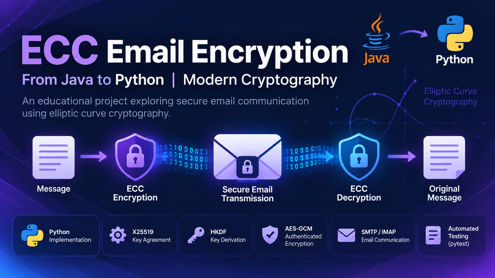

# 🔐 ECC Email Encryption — Python

From an Academic Java Project to a Modern Python Implementation

An educational cryptography project exploring secure email communication using elliptic curve cryptography (ECC).

Originally developed in Java as my Bachelor's graduation project in Computer Science, this project was later revisited and reimplemented in Python to explore modern cryptographic techniques and improve the original design.

## 🎯 Project Overview

The project demonstrates how cryptographic techniques can be applied to protect email content.

It combines two learning objectives:

1. Understanding elliptic curve cryptography through an educational implementation.
2. Exploring modern hybrid encryption techniques using Python.

## 🛠️ Technologies

- Python — Main programming language
- X25519 — Elliptic-curve key agreement
- HKDF — Cryptographic key derivation
- AES-GCM — Authenticated encryption
- SMTP / IMAP — Email communication
- pytest — Automated testing

## 📂 Project 

```text
ecc-email-encryption/
├── src/
│   └── ecc_mail/
│       ├── cli.py
│       ├── config.py
│       ├── crypto.py
│       ├── keys.py
│       ├── mail_client.py
│       └── toy_ecc.py
├── tests/
├── .env.example
├── .gitignore
├── LICENSE
├── pyproject.toml
└── requirements.txt
```

## 🔄 Project Evolution

Original Academic Project — Java

My undergraduate graduation project explored an end-to-end email encryption scheme based on elliptic curve cryptography.

Modern Implementation — Python

I revisited the original concept and developed a Python implementation using modern cryptographic primitives.

The project also preserves a simplified ECC implementation for educational purposes.

## 🔒 Security Notes

This repository is intended for educational and experimental use.

The simplified ECC implementation is for learning purposes only and must not be used to protect real-world sensitive information.

The project has not undergone an independent security audit and should not be considered a production-ready secure email solution.

Never commit real email passwords, API keys, or ".env" files.

## 🧪 Testing

The repository includes automated tests for the cryptographic components and application functionality.

To run the tests after installing the project dependencies:

python -m pytest

## 👩‍💻 Developer

Abeer Eissa

Computer Science Lecturer | Python Programming Trainer

Teaching Philosophy: Think Before You Code.

Exploring the connection between computer science fundamentals, practical programming, and secure communication.
